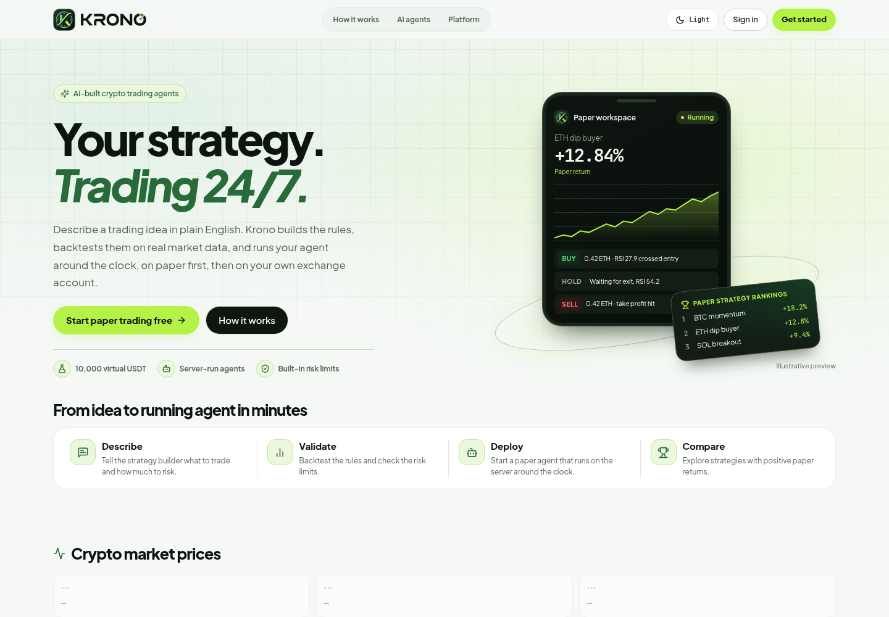
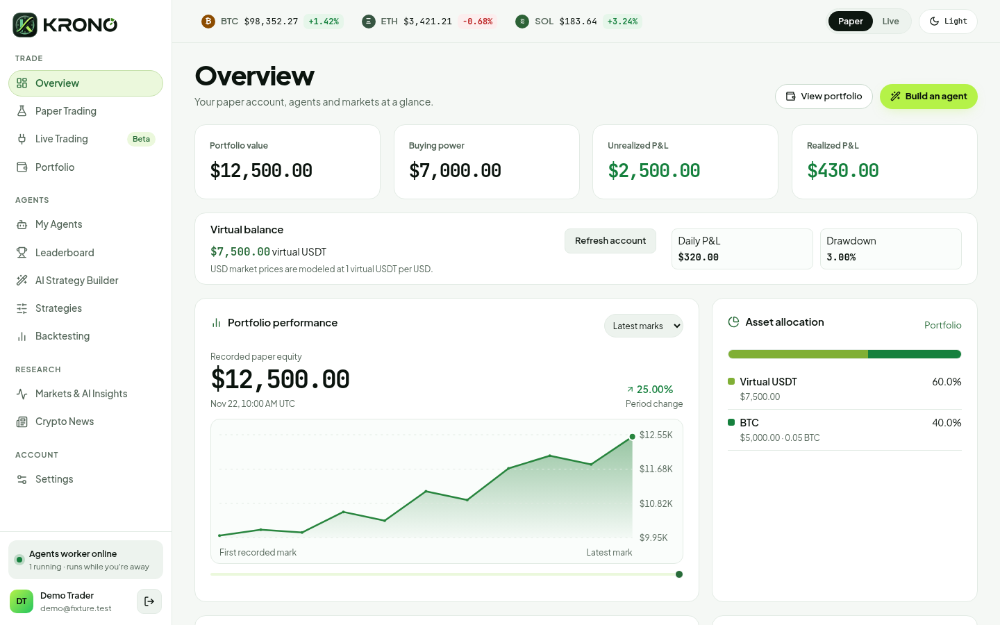
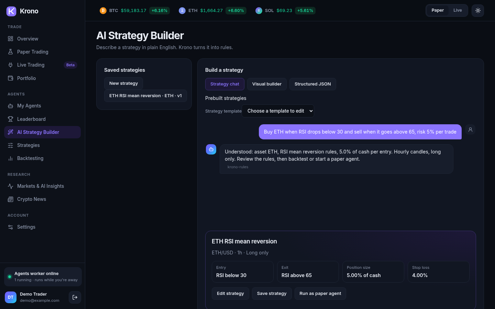
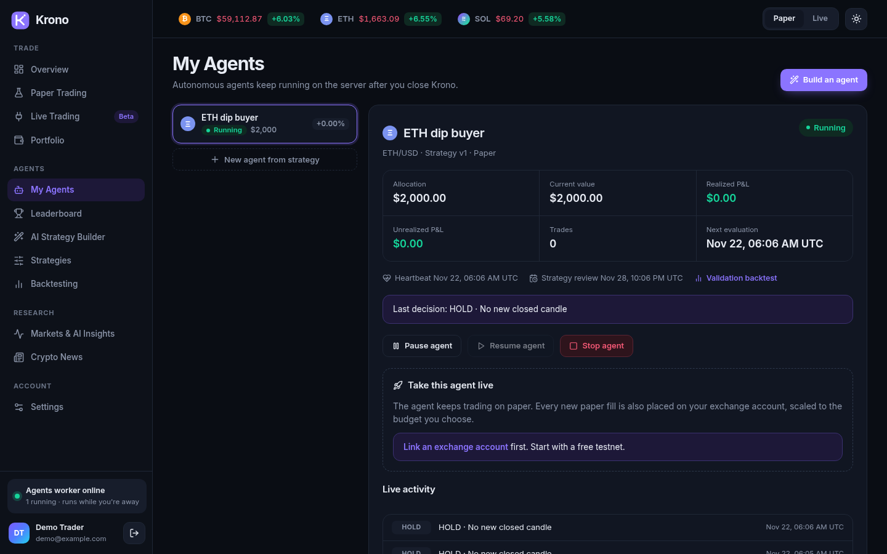
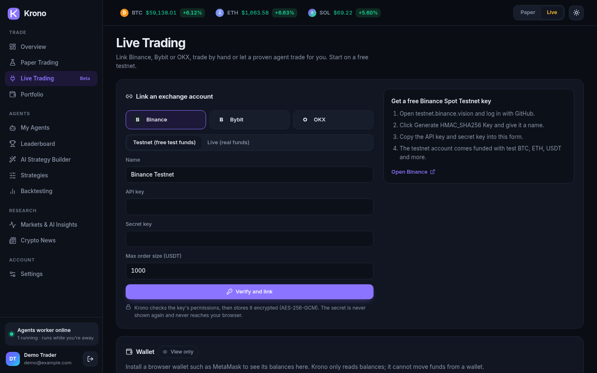
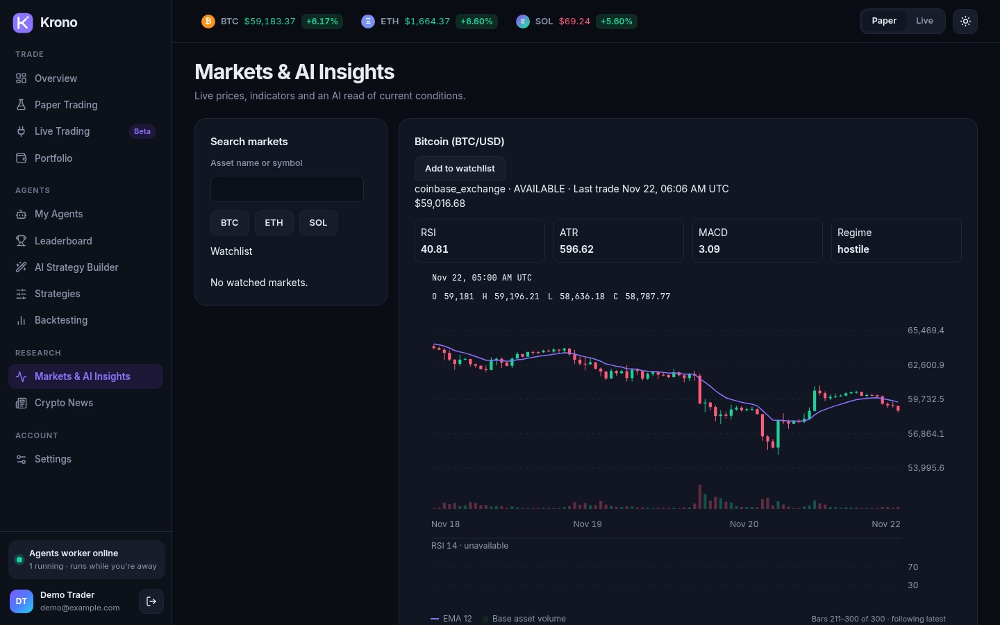
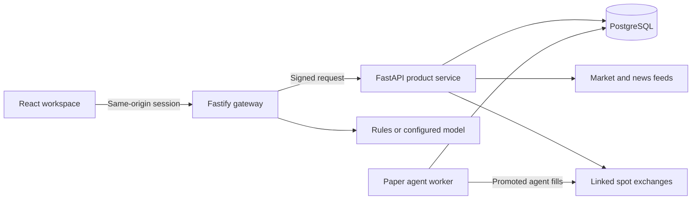

<div align="center">

# Krono

**Build a crypto strategy in plain English, backtest it, and run it as a paper agent. Then connect a supported spot exchange for testnet or live trading.**

[Quick start](#quick-start) · [Workspace](#workspace) · [Screenshots](#screenshots) · [Live trading](#live-trading) · [Deployment](#deployment)

<picture>
  <source media="(prefers-color-scheme: dark)" srcset="docs/screenshots/landing-dark.png">
  
</picture>

</div>

## Quick start

You need Node.js 22.12 or later, `uv`, and Docker. To use your own PostgreSQL server, set `KRONO_DATABASE_DSN` before starting. [uv installation](https://docs.astral.sh/uv/getting-started/installation/)

```bash
make setup
make dev
```

Open the URL printed by `make dev` and create a local account. New paper accounts start with **10,000 virtual USDT** by default. [Default local URL](http://127.0.0.1:5173)

The launcher starts PostgreSQL, applies migrations, and starts the API, gateway, worker, and frontend. Keep it running while local agents are active. Local database, session, and exchange encryption secrets are stored in `.runtime/dev.json`. Keep this file with your local database backup.

### Run your first paper agent

1. Open **AI Strategy Builder** and enter a prompt such as “Buy ETH when RSI is below 30 and sell when RSI is above 70. Use 5% of available cash per entry and a 3% stop loss.”
2. Answer any follow-up questions and review the draft. Choose **Save strategy** if you want to test that version in **Backtesting** first.
3. In the builder, choose **Run as paper agent**, set an allocation and risk limits, then choose **Start paper agent**. The worker backtests the rules and applies risk checks before placing simulated orders. Track its status and decisions in **My Agents**.

Krono evaluates long-only spot strategies on closed hourly candles. The paper worker runs on the server after the browser closes.

## Workspace

| Area                                      | What you can do                                                                                                                                               |
| ----------------------------------------- | ------------------------------------------------------------------------------------------------------------------------------------------------------------- |
| **Overview**                              | Switch between the **Paper dashboard** for virtual equity, allocation, and recent orders and the **Live dashboard** for linked exchange balances.             |
| **AI Strategy Builder**                   | Draft entry, exit, and sizing rules in chat. The builder asks for missing details before producing a validated draft.                                         |
| **Backtesting**                           | Replay a saved strategy version on historical candles. Compare in-sample and chronological holdout results, then inspect trades, drawdown, and modeled costs. |
| **Paper Trading and My Agents**           | Place simulated market or limit orders, watch balances and fills, and manage agents that run in the background.                                               |
| **Strategies**                            | Browse strategies ranked by recorded paper returns and copy an entry to your own library. Open **Settings → My strategies** to manage your saved versions.    |
| **Markets & AI Insights and Crypto News** | Browse eligible spot markets, save a watchlist, inspect charts and indicators, and generate a summary from market data and recent headlines.                  |
| **Live Trading**                          | Link Binance, Bybit, or OKX, place manual spot orders, and mirror eligible agents within a budget you set.                                                    |

### Local settings

Use `.env` for local overrides and `.env.local` for private provider keys. The built-in rules mode supports drafting and market summaries without a model key. Configure an OpenAI-compatible endpoint or Amazon Bedrock for model-backed responses. [Example environment settings](.env.example)

| Setting                                       | Purpose                                                                                                      |
| --------------------------------------------- | ------------------------------------------------------------------------------------------------------------ |
| `KRONO_LLM_PROVIDER`                          | Select `rules`, `groq`, or `bedrock`. Local development uses `rules` by default when no Groq key is present. |
| `GROQ_API_KEY`, `GROQ_BASE_URL`, `GROQ_MODEL` | Configure Groq or another OpenAI-compatible endpoint.                                                        |
| `KRONO_DATABASE_DSN`                          | Use an existing PostgreSQL server.                                                                           |
| `KRONO_PAPER_INITIAL_USDT`                    | Set the opening credit for new paper accounts.                                                               |
| `KRONO_CONFIG_PATH`                           | Load a custom runtime configuration for market providers and paper trading limits.                           |

## Screenshots

Krono defaults to light mode and remembers your theme choice. These captures use a local demo account and fixture market data.

### Paper dashboard

<picture>
  <source media="(prefers-color-scheme: dark)" srcset="docs/screenshots/overview.png">
  
</picture>

### AI Strategy Builder



### Agent monitoring



<table>
  <tr>
    <td width="50%"><strong>Paper Trading</strong><br></td>
    <td width="50%"><strong>Live Trading</strong><br></td>
  </tr>
  <tr>
    <td width="50%"><strong>Markets &amp; AI Insights</strong><br></td>
    <td width="50%"><strong>Crypto News</strong><br></td>
  </tr>
</table>

## Live trading

Connect Binance Spot Testnet, Bybit Testnet, or OKX demo trading to try the exchange flow with test funds. Real-funds accounts use trade-only API keys with withdrawals disabled. Krono encrypts stored keys, applies per-connection order caps, and reconciles uncertain submissions using client order IDs. The browser wallet panel displays balances in view-only mode.

To mirror an agent to a real-funds account, it must meet the paper history requirement (seven days by default) and you must confirm promotion. The exchange connection’s kill switch blocks new live orders and cancels open orders. [Live trading guide](docs/LIVE_TRADING.md)

## Architecture



The product service owns strategy versions, replay reports, the paper ledger, and exchange connections. The worker uses database leases and checkpoints to process due jobs and recover across restarts. [Architecture guide](docs/ARCHITECTURE.md)

## Deployment

- **Docker Compose** runs PostgreSQL 18, migrations, the private Product API, and the paper worker. The gateway and frontend run separately. [Compose setup](docs/DEVELOPMENT.md#container-topology-and-recovery)
- **AWS CDK** defines CloudFront, Cognito, ECS Fargate services for the gateway, Product API, and paper worker, and an encrypted Aurora PostgreSQL cluster. The deployment uses ECR image digests and Secrets Manager. [AWS setup](docs/AWS_SETUP.md)

## Development

```bash
npm run build:platform
make test
npm run test:e2e
```

Set `KRONO_TEST_DATABASE_DSN` to a disposable database to run PostgreSQL integration tests. The development guide covers browser fixture configuration and the optional research CLI. [Development guide](docs/DEVELOPMENT.md#local-checks)

| Path                                      | Responsibility                                           |
| ----------------------------------------- | -------------------------------------------------------- |
| `frontend/src/platform/`                  | React workspace, dashboards, and strategy workflow       |
| `backend/gateway/`                        | Sessions, CSRF, signed forwarding, and model integration |
| `backend/product/`, `backend/migrations/` | Product API, worker, and PostgreSQL schema               |
| `deploy/`, `infra/`                       | Container definitions and AWS infrastructure             |
| `backend/tests/`, `tests/e2e/`            | Backend, interaction, and recovery tests                 |
| `cli/`, `tradingagents/`                  | Inherited research CLI and analytical components         |

## Credits and license

Krono uses Coinbase Exchange and Binance for market data, cryptocurrency.cv for news, and TradingAgents for analytical components. The repository is licensed under Apache 2.0. [Third-party notices](THIRD_PARTY_NOTICES.md) · [License](LICENSE)
