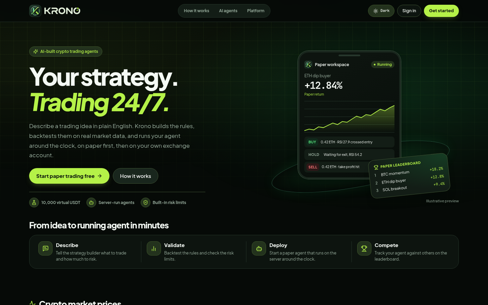
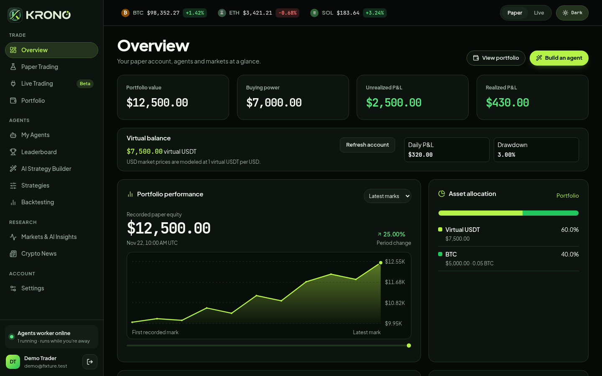
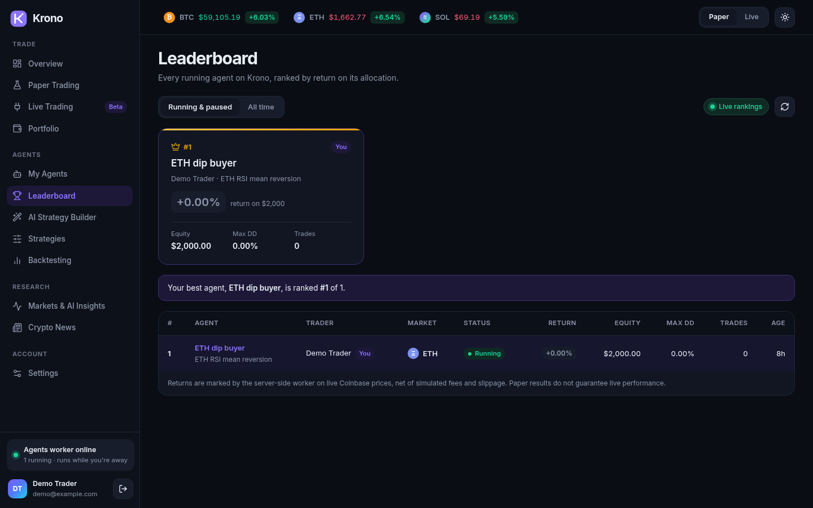
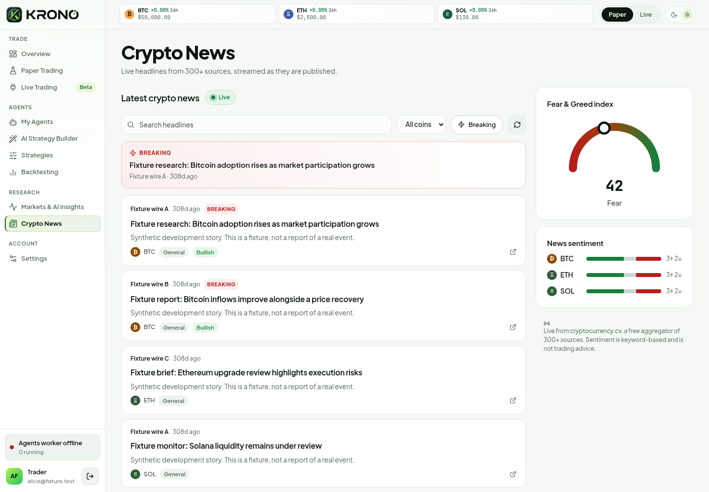
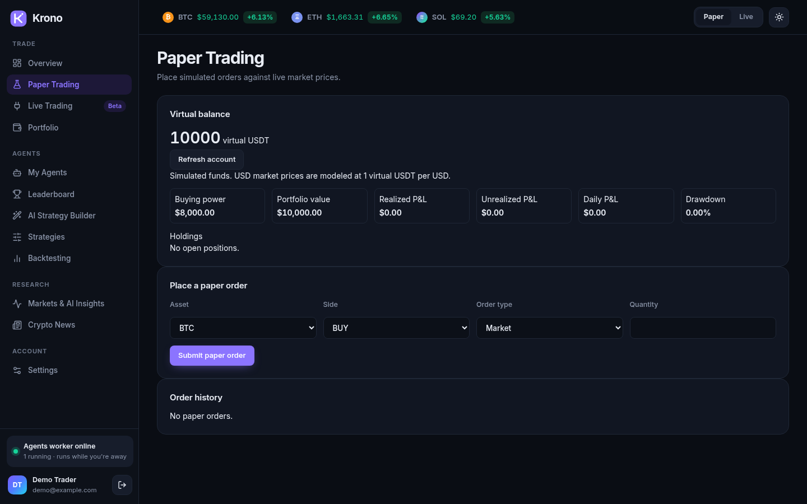
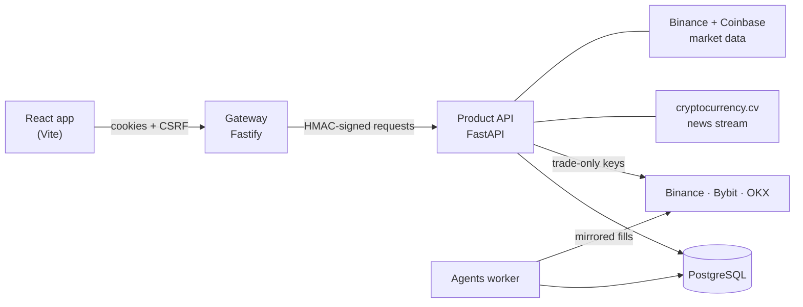

<div align="center">

# Krono

**Automated crypto trading agents. Describe a strategy in plain English, backtest it, and let it trade around the clock: on paper first, then on your own exchange account.**

[Features](#features) · [Screenshots](#screenshots) · [Quick start](#quick-start) · [How it works](#how-it-works) · [Live trading](#live-trading) · [Development](#development)

<picture>
  <source media="(prefers-color-scheme: light)" srcset="docs/screenshots/landing-light.png">
  
</picture>

</div>

## Features

|                                 |                                                                                                                                                                                                                                     |
| ------------------------------- | ----------------------------------------------------------------------------------------------------------------------------------------------------------------------------------------------------------------------------------- |
| 🤖 **AI strategy builder**      | Chat a trading idea ("buy ETH when RSI drops below 30, sell above 65, 5% per trade"), and Krono turns it into rules you can edit, backtest and run. Works offline with a built-in rules drafter, or with any OpenAI-compatible LLM. |
| ⏱️ **Agents that keep running** | Agents run in a server-side worker with leases and checkpoints, so they keep trading after you close the browser and resume safely after a restart.                                                                                 |
| 🧪 **Paper trading**            | Every account gets 10,000 virtual USDT, filled against live Coinbase prices with simulated fees and slippage. Trade by hand or with agents.                                                                                         |
| 🔌 **Live trading**             | Link Binance, Bybit or OKX with a trade-only API key; each has a free testnet. Trade by hand, or promote a proven paper agent so its trades are mirrored to your account at a budget you choose.                                    |
| 🏆 **Leaderboard**              | Every running agent on the platform, ranked by return on its allocation, with live-trading badges.                                                                                                                                  |
| 📰 **Live news and sentiment**  | Real-time headlines from 300+ sources through [cryptocurrency.cv](https://github.com/nirholas/cryptocurrency.cv), plus the Fear & Greed index and per-coin sentiment.                                                               |
| 📈 **Live markets**             | Streaming Binance prices in the ticker, candlestick charts with RSI, ATR, MACD and a market-regime read.                                                                                                                            |
| 👛 **Wallet view**              | Connect MetaMask or any EIP-1193 wallet to see balances next to your exchange accounts. View-only: Krono never asks you to sign anything.                                                                                           |
| 🌗 **Light and dark themes**    | Starts in light mode, with a toggle that remembers your choice.                                                                                                                                                                     |

Every data source is free and needs no API key.

## Screenshots

### Overview

<picture>
  <source media="(prefers-color-scheme: light)" srcset="docs/screenshots/overview-light.png">
  
</picture>

### AI strategy builder

Describe a strategy in a sentence. Krono drafts the entry and exit rules, position size and stop loss, ready to save, backtest or run as an agent.


### My Agents

Each agent shows its allocation, P&L, last decision and heartbeat. Once it passes validation it can be taken live.


<table>
  <tr>
    <td width="50%">
      <strong>Leaderboard</strong><br>
      
    </td>
    <td width="50%">
      <strong>Live trading</strong><br>
      
    </td>
  </tr>
  <tr>
    <td width="50%">
      <strong>Crypto news</strong><br>
      
    </td>
    <td width="50%">
      <strong>Markets & AI insights</strong><br>
      
    </td>
  </tr>
  <tr>
    <td width="50%">
      <strong>Paper trading</strong><br>
      
    </td>
    <td width="50%">
      <strong>Light theme</strong><br>
      
    </td>
  </tr>
</table>

## Quick start

**Requirements:** Node 22+, [uv](https://docs.astral.sh/uv/), and Docker (for PostgreSQL).

```bash
make setup   # Python and Node dependencies, production build
make dev     # PostgreSQL, migrations, API, agents worker, gateway and UI
```

Open **http://127.0.0.1:5173**, create an account, and you're trading on paper.

`make dev` starts everything in one terminal and generates its local secrets in `.runtime/dev.json` (keep that file: it holds the key that encrypts linked exchange keys).

| Service     | Address                 |
| ----------- | ----------------------- |
| Web app     | `http://127.0.0.1:5173` |
| Gateway     | `http://127.0.0.1:8790` |
| Product API | `http://127.0.0.1:8794` |
| PostgreSQL  | `127.0.0.1:55432`       |

### A first agent in two minutes

1. Open **AI Strategy Builder** and type a strategy, for example _"Buy ETH when RSI drops below 30 and sell when it goes above 65, risk 5% per trade"_.
2. Click **Run as paper agent**, then **Start paper agent**. The worker backtests it and applies risk checks before it starts.
3. Close the browser. The agent keeps trading; open **My Agents** or the **Leaderboard** later to see how it did.

### Optional configuration

Copy [`.env.example`](.env.example) to `.env` to change defaults:

| Variable                                      | Purpose                                                                                                                       |
| --------------------------------------------- | ----------------------------------------------------------------------------------------------------------------------------- |
| `GROQ_API_KEY`, `GROQ_BASE_URL`, `GROQ_MODEL` | Use an LLM for the strategy chat (Groq or any OpenAI-compatible endpoint). Without a key, the built-in rules drafter is used. |
| `KRONO_PAPER_INITIAL_USDT`                    | Starting virtual balance (default 10,000).                                                                                    |
| `KRONO_LIVE_PROMOTION_DAYS`                   | Days of paper trading before an agent may trade real funds (default 7).                                                       |
| `KRONO_CREDENTIAL_KEY`                        | Key that encrypts linked exchange keys. `make dev` generates one.                                                             |

## How it works



- **Gateway** (`backend/gateway/`): sign-in, sessions, CSRF, rate limits and the strategy chat. It forwards every product request to the API with a signed, short-lived HMAC header.
- **Product API** (`backend/product/`): strategies, backtests, the paper ledger, leaderboard, live connections and orders. It fans out one upstream news stream and one price stream to every browser over Server-Sent Events.
- **Agents worker** (`backend/product/worker.py`): evaluates each running agent on every closed candle, records fills in the paper ledger and mirrors promoted agents' fills to their exchange. Leases and checkpoints keep each agent on exactly one worker and make restarts safe.

See [architecture](docs/ARCHITECTURE.md) for the full design.

## Live trading

Live trading uses a **trade-only API key** from your exchange, never a wallet signature, so agents can trade without you approving each transaction.

| Exchange | Free test environment                                                |
| -------- | -------------------------------------------------------------------- |
| Binance  | [Spot Testnet](https://testnet.binance.vision/) (log in with GitHub) |
| Bybit    | [Testnet](https://testnet.bybit.com/)                                |
| OKX      | Demo trading (in the OKX app)                                        |

**Safety measures**

- Keys that can withdraw funds are rejected for real-funds accounts.
- Keys are encrypted with AES-256-GCM, bound to their owner and connection, and never sent back to the browser.
- Every order has an idempotent client ID and is reconciled with the exchange if its outcome is unknown.
- Each account has a max order size and a kill switch that pauses trading and cancels open orders.
- An agent needs 7 days on paper and an explicit confirmation before it can trade real funds. Testnet accounts work immediately.

The step-by-step guide and API routes are in [live trading](docs/LIVE_TRADING.md).

> [!WARNING]
> Crypto trading carries real risk. Paper results do not guarantee live performance. Start on a testnet and use small budgets.

## Development

```bash
make test          # Python tests, gateway tests, frontend type check and build
npm run test:e2e   # Browser tests (Playwright, isolated fixtures)
```

The PostgreSQL integration tests run when `KRONO_TEST_DATABASE_DSN` points to a scratch database; otherwise they are skipped.

| Folder                | Contents                                                                     |
| --------------------- | ---------------------------------------------------------------------------- |
| `frontend/`           | React app: landing page, workspace, leaderboard, strategy chat, live trading |
| `backend/product/`    | FastAPI service, strategies, backtests, paper ledger, live trading, worker   |
| `backend/gateway/`    | Fastify gateway: sign-in, CSRF, rate limits, strategy drafting, signed proxy |
| `backend/migrations/` | PostgreSQL schema migrations                                                 |
| `tradingagents/`      | Indicator, regime and sizing components reused by the backend                |
| `tests/e2e/`          | Browser tests                                                                |
| `deploy/`, `infra/`   | Containers and AWS infrastructure                                            |
| `docs/`               | Architecture, development, live trading and verification                     |

More in [development](docs/DEVELOPMENT.md), [verification](docs/VERIFICATION.md), [AWS setup](docs/AWS_SETUP.md) and [security](SECURITY.md).

## Credits and license

- News: [cryptocurrency.cv](https://github.com/nirholas/cryptocurrency.cv), free and keyless.
- Market data: Binance public market data and Coinbase Exchange.
- Indicator, regime and sizing components reuse the TradingAgents framework.

See [third-party notices](THIRD_PARTY_NOTICES.md). Krono is released under the [Apache 2.0 license](LICENSE).
