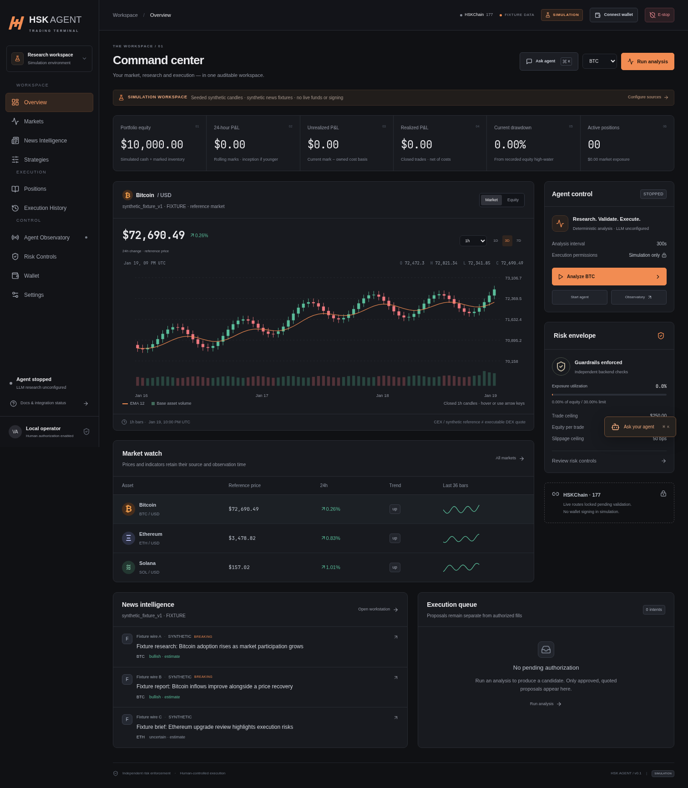

# Krono — an auditable crypto trading workspace

**AEGIS Phases 1–2:** verified HSKSwap V3 data, typed routes/quotes, a paper execution gateway and an idempotent SQLite ledger now work independently of the terminal. Run `make setup && make prices`, then `make paper-demo`. A real-mainnet-quote paper round trip recorded 100 → **99.972016 USDT** after LP fees, modeled slippage and modeled network costs. See [discovery](docs/DISCOVERY.md) and [paper methodology](docs/PAPER.md). Browser screenshots were waived by the user; visual UI matching remains unverified. Guard deployment, autonomous strategies, on-chain decisions and the AEGIS chat/dashboard are still pending.

**KRONO 2.0:** a Cognito/DynamoDB tenant control plane, centralized Bedrock MiniMax provider, conversational agent drafts and isolated ECS runtime infrastructure have been added. Configure your account using [the AWS setup guide](docs/AWS_SETUP.md) and [environment template](deploy/aws/.env.example). Cloud deployment and model access remain pending account configuration; the local simulation terminal still runs independently.

Research → deterministic strategy → independent risk → quote preview → human authorization → simulated execution → reconciled portfolio.

Krono is an independent platform built for the HSKSwap AI Agent Trading hackathon track, extending [AlpacaTradingAgent](https://github.com/vishal88736/alpaca-trading-agent). HSKSwap is the target exchange integration on HSKChain. Python, LangGraph, FastAPI and SQLite power a React/TypeScript/Tailwind terminal. The original trading framework, Dash interface and Alpaca utilities remain in the repository.

**The Krono terminal's working execution mode is SIMULATION. Live HSKSwap swaps remain disabled.** AEGIS's standalone CLI supports paper fills against verified mainnet QuoterV2 quotes; that flow has not been wired into the Krono UI. No wallet signing, profitable strategy, production readiness or blockchain execution is claimed.



The interface uses self-hosted Inter, brighter charcoal surfaces, lavender controls, a compact icon rail and original dimensional coin artwork. The discovery cards support filtering, sorting, grid/list views, versioned configuration and measured backtests. Reference-price previews are explicitly distinguished from strategy performance. Workspace search opens real markets and application sections. HSKSwap is identified as an exchange integration rather than the platform brand.

## Start locally

Requires Node **22.12+**, `uv`, and Python **3.12**. The commands below keep Python downloads and caches inside this project. Initial setup downloads Python if needed and the locked Python/npm dependencies. No model weights, wallet credentials or API keys are needed for simulation.

```bash
export UV_CACHE_DIR="$PWD/.cache/uv"
export UV_PYTHON_INSTALL_DIR="$PWD/.python"
uv sync --frozen --python 3.12
npm ci
npm run dev
```

Open **http://127.0.0.1:5173**. The API listens on `127.0.0.1:8787`. Stop both development processes with Ctrl+C.

Optional server settings: copy `.env.example` to `.env`, then edit the relevant fields. `npm run dev` loads that file without exposing its contents to Vite's client bundle. Existing shell environment variables take precedence. Never add real credentials to frontend environment variables.

To run the built application with one local server:

```bash
npm run build
.venv/bin/python -m uvicorn backend.api:app --host 127.0.0.1 --port 8787
```

Open **http://127.0.0.1:8787**. To load `.env` in this command, use `uv run --frozen --no-sync --env-file .env python -m uvicorn backend.api:app --host 127.0.0.1 --port 8787` instead.

## A reproducible demo

1. For the deterministic walkthrough, explicitly select **synthetic fixtures** for both providers before trading. Normal startup now uses live reference feeds with simulated execution. Simulation capital comes from `config/runtime.json` (default $10,000), with no owned positions. Fixture prices/stories are not current market reports.
2. Click **Analyze BTC**. Inspect the real stage records in **Agent Observatory**, including the indicator values, deterministic signals and independent risk decision. With no model configured, the LLM stage says **SKIPPED**.
3. Open **Execution History**. Review the approved amount, exact input, minimum output, costs, quote age and exit policy. Quotes expire after 20 seconds; refresh an expired preview. A proposal older than 120 seconds needs a new analysis.
4. Click **Authorize simulated fill**. The ledger records one fill, updates cash/holdings/fees/P&L, and records a `sim:` receipt. There is no blockchain transaction hash.
5. Inspect **Positions**, **Risk Controls** and **Settings → audit trail**. Repeated authorization cannot create another fill. A manual exit also requires its own preview, risk checks and authorization.
6. Ask the assistant to **lower maximum trade size to 0.5% of equity**, **disable momentum strategy**, or **pause all new entries**. These are validated server-side tools. The assistant cannot raise exposure limits, sign transactions or bypass the execution pipeline.
7. Press **E-stop**. The backend latches the stop immediately. Clearing it in Risk Controls leaves entries paused until an explicit resume.

Full walkthrough, including autonomous simulation and restart recovery: [DEMO.md](docs/DEMO.md).

## Implemented and externally blocked

| Capability                                                                             | Evidence / boundary                                                                                                                                                                                                                               |
| -------------------------------------------------------------------------------------- | ------------------------------------------------------------------------------------------------------------------------------------------------------------------------------------------------------------------------------------------------- |
| Ten terminal workspaces, responsive navigation, candles, volume, EMA and equity charts | Built and exercised with Chromium at desktop and mobile sizes. 1h/4h/1d charts use complete buckets; analysis remains hourly.                                                                                                                     |
| Market and news ingestion                                                              | Typed Coinbase reference prices/candles and hosted cryptocurrency.cv news/breaking feeds; bounded concurrency, timeouts, caching and stale/unavailable states.                                                                                    |
| Strategy registry                                                                      | Five built-ins: momentum, mean reversion, trend following, breakout and arbitrage detection. Dynamic ranking uses measured inputs; arbitrage remains ineligible without verified executable routes.                                               |
| Upstream framework reuse                                                               | Original regime classifier, Wilder ATR, bull/bear node factories, structured trader schema and provider factory. 220 of 223 preserved upstream files are byte-identical; three small adaptations are documented.                                  |
| Optional AI research                                                                   | Actual upstream bull/bear nodes and a structured trader consolidation; bounded, read-only and subordinate to deterministic strategies/risk. Tested with a fixture model; no live LLM provider has been validated in this run.                     |
| Independent risk and simulation execution                                              | Decimal amounts, hard caps, fresh-quote validation, explicit authorization, idempotent intents, transaction-state separation and atomic ledger reconciliation.                                                                                    |
| Scheduler and audit                                                                    | Single active run, separate pause/stop/emergency controls, safe restart recovery, persistent configuration versions and paginated records. Automatic fills require explicit simulation-only permission.                                           |
| Backtests                                                                              | Chronological next-open execution, entry-bar/standing stops, fees, slippage, risk caps and a frozen chronological holdout; assumptions and unavailable metrics are exposed.                                                                       |
| HSKChain read-only integration                                                         | Official network/token identity references, chain-ID checks, native balance lookup and receipt status lookup. Native RPC probe confirmed chain 177. Token decimals, executable routes, signing and live balance reconciliation remain unverified. |
| Alpaca compatibility                                                                   | Original adapter and Dash/CLI source preserved, with separate optional paper-account inspection. HSKSwap requests never route to Alpaca. Full legacy provider/UI execution was not tested.                                                        |

## Data, modes and permissions

New workspaces default to Coinbase reference prices and cryptocurrency.cv news while execution remains SIMULATION. Existing saved provider settings take precedence over environment defaults: select **Settings → Data providers** to change them. **Settings → Feed refresh** configures short ticker caching separately from closed hourly history and news. News search/category/asset filters operate on normalized loaded feeds; they do not pretend to be historical article search. Provider free-tier limits are shown when present. Changing market sources after fills requires a new simulation database to preserve comparable P&L provenance.

Read [Understanding KRONO](docs/codebase/README.md) for the directory/module guide, actual API/source reference, configuration precedence, debugging workflow and backend audit. Public operational defaults live in [config/runtime.json](config/runtime.json); mandatory risk and authorization safeguards remain in trusted code.

Reference symbols such as BTC are distinct from HSKChain tokens such as WBTC. Documented token addresses, chain IDs, decimals and verification status are separate fields. Unknown decimals remain unknown. A read-only wallet connection never establishes cost basis, authenticates ownership or merges real balances into simulated P&L.

SIMULATION never signs. The terminal does not expose a functioning PAPER or LIVE toggle. `TERMINAL_MODE=LIVE` cannot enable execution. The preserved Alpaca paper workflow is separate; it is not HSKSwap paper trading.

The local interface uses an HttpOnly SameSite session, trusted origins and CSRF protection. CLI clients may use a server-configured bearer token. State changes are validated and audited; the UI is not the enforcement boundary. SQLite/runtime files are ignored by Git. Raw chat stays in tab memory; typed tool events are persisted. Ambient LangSmith tracing is disabled around terminal research runs.

Run a single backend process/worker for this local modular monolith. Multi-user hosting, production TLS/identity, external wallet signing, contract audits, live execution and comprehensive legacy dependency validation are outside the verified deployment boundary. See [SECURITY_AND_LIMITS.md](docs/SECURITY_AND_LIMITS.md).

## Validate

```bash
.venv/bin/python -m pytest backend/tests legacy_tests/test_regime_detection.py legacy_tests/test_backtest_engine.py legacy_tests/test_portfolio_intelligence.py -q
.venv/bin/ruff check backend scripts
.venv/bin/ruff format --check backend scripts
npm run build
npm run test:e2e
.venv/bin/python -m scripts.production_smoke
.venv/bin/python -m scripts.public_audit
```

Chromium tests use the installed `/usr/bin/chromium` when available. Otherwise install Playwright's browser into the project cache with `PLAYWRIGHT_BROWSERS_PATH="$PWD/.cache/ms-playwright" npx playwright install chromium`, and keep that variable set for the test command. CI installs its own browser and OS dependencies on its disposable runner.

Validation commands and evidence boundaries are recorded in [VERIFICATION.md](docs/VERIFICATION.md). The AWS control-plane suites run with isolated providers and synthesized infrastructure; they do not verify account-level deployment or model access. A third-party LangGraph deprecation warning remains. No test establishes profitability or live trading.

Public read-only provider probes are opt-in and separate from offline tests:

```bash
.venv/bin/python -m scripts.verify_providers --network
```

## Architecture and provenance

- [Architecture and contracts](docs/ARCHITECTURE.md)
- [Strategy assumptions and inherited strategy reference](docs/STRATEGIES.md)
- [Verified endpoints, HSKSwap research and missing requirements](docs/INTEGRATIONS.md)
- [Initial repository audit and implementation plan](docs/IMPLEMENTATION_PLAN.md)
- [Preserved upstream documentation](docs/upstream/README.md)

The inherited framework is Apache-2.0 licensed. See [LICENSE](LICENSE) and [THIRD_PARTY_NOTICES.md](THIRD_PARTY_NOTICES.md). cryptocurrency.cv is consumed as a hosted API; its service source was not copied or deployed.
