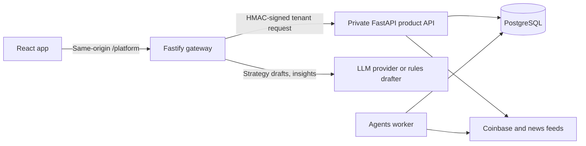

# Krono architecture

## Services

- **Frontend** (`frontend/src/`): the landing page, sign-in and the workspace. The workspace includes the dashboard, paper trading, live trading, agents, leaderboard, AI strategy builder, backtesting, markets and news. Light and dark themes share one token palette in `styles/palette.css`.
- **Gateway** (`backend/gateway/`): authenticates every request and enforces origin and CSRF checks. It forwards to the product API with a short-lived HMAC signature over the subject, method, path and body digest. Sign-in is either `local` (accounts in PostgreSQL, signed session cookie) or `cognito`. Strategy chat calls the configured model, or the built-in rules drafter when no key is set. The gateway validates every draft against the product schema before returning it.
- **Product API** (`backend/product/api.py`): accounts, strategies and versions, backtests, the paper ledger, agents, the leaderboard, markets and news. It trusts only signed gateway requests. Account routes under `/platform/internal/` accept only the gateway's service subject.
- **Agents worker** (`backend/product/worker.py`): claims due agents from PostgreSQL with row locks and leases. It validates each pinned strategy version with a replay, then evaluates rules on each closed hourly candle and protective exits on fresh quotes. Orders, decisions, checkpoints and equity marks commit together. The worker is independent of the browser and the API: closing the tab, signing out or restarting the API never stops an agent, and a crashed worker resumes from its checkpoint.
- **Leaderboard** (`GET /platform/leaderboard`): ranks running and paused agents across all accounts by return on their own allocation. It uses the worker's equity marks and reports max drawdown and trade counts. Other users' agent IDs are never returned, and owners appear by display name or an anonymous handle.

## Paper and live trading

Paper trading is complete: virtual USDT, live reference prices, fees, slippage, account-wide and per-agent risk limits, and an emergency stop. Live trading is not enabled yet. The Live Trading page and [live trading design](LIVE_TRADING.md) describe how exchange accounts will be linked.

See [development](DEVELOPMENT.md) for configuration, tests and deployment.
