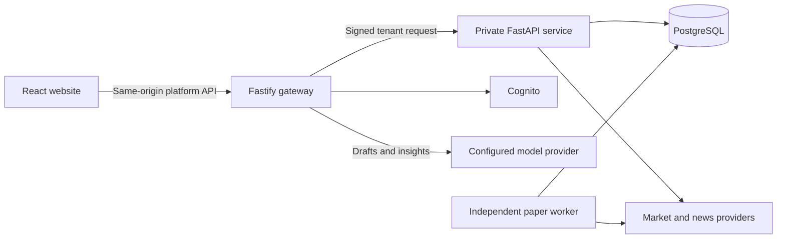

# Krono architecture

## Product services

- `frontend/src/platform/` renders the authenticated workspace and public landing page.
- `backend/gateway/` validates Cognito sessions and CSRF, derives tenant identity and signs requests to the private product service. It validates model-generated strategy drafts before returning them.
- `backend/product/api.py` owns account, strategy, backtest, market, news, and agent APIs. `backend/product/execution.py` applies deterministic checks and posts both manual and agent fills to the same ledger.
- `backend/product/worker.py` claims due work from PostgreSQL, pins a saved strategy version and historical report, and evaluates rules against closed candles and fresh quotes. Work leases, checkpoints and fill keys support recovery. The worker runs independently of the website and API.
- `backend/migrations/` defines the PostgreSQL ledger, tenant records and durable work queue.

## Operator tools

The separate [HashKey operator API](operator/AEGIS_FLOWS.md), chain connectors and contracts retain their historical workflows and verification evidence. They use their own local records and operator entry points. The website uses the product API and paper ledger. Live trading is disabled in the product gateway.

See [development](DEVELOPMENT.md) for startup and deployment paths, [consolidation](CONSOLIDATION.md) for the migration map, and the [original architecture audit](ARCHITECTURE_AUDIT.md) for historical context.
