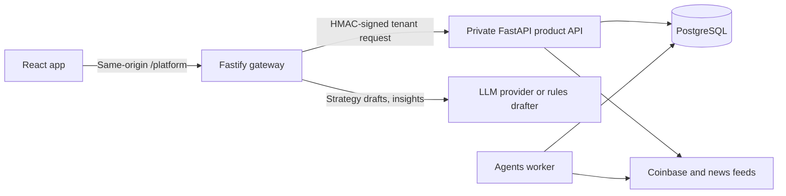

# Krono architecture

## Services

- **Frontend** (`frontend/src/`): the landing page, sign-in and the workspace. The workspace includes the dashboard, paper trading, live trading, agents, ranked strategies, AI strategy builder, backtesting, markets and news. Light and dark themes share one token palette in `styles/palette.css`.
- **Gateway** (`backend/gateway/`): authenticates every request and enforces origin and CSRF checks. It forwards to the product API with a short-lived HMAC signature over the subject, method, path and body digest. Sign-in is either `local` (accounts in PostgreSQL, signed session cookie) or `cognito`. Strategy chat calls the configured model, or the built-in rules drafter when no key is set. The gateway validates every draft against the product schema before returning it.
- **Product API** (`backend/product/api.py`): accounts, strategies and versions, backtests, the paper ledger, agents, the leaderboard, markets and news. It trusts only signed gateway requests. Account routes under `/platform/internal/` accept only the gateway's service subject.
- **Agents worker** (`backend/product/worker.py`): claims due agents from PostgreSQL with row locks and leases. It validates each pinned strategy version with a replay, then evaluates rules on each closed hourly candle and protective exits on fresh quotes. Orders, decisions, checkpoints and equity marks commit together. The worker is independent of the browser and the API: closing the tab, signing out or restarting the API never stops an agent, and a crashed worker resumes from its checkpoint.
- **Live news** (`backend/product/news_hub.py`): one server-side connection to the free, keyless [cryptocurrency.cv](https://github.com/nirholas/cryptocurrency.cv) Server-Sent Events stream feeds a de-duplicated buffer of 300 articles, with REST polling as a fallback. Browsers load `GET /platform/news/live`, then subscribe to `GET /platform/news/stream`, so the provider sees one client however many users are reading. `GET /platform/news/pulse` adds the Fear & Greed index and per-coin sentiment, cached for 5 minutes. The project uses only the hosted API: its license allows free use of the hosted service but requires permission to self-host or redistribute the code.
- **Live prices** (`backend/product/price_hub.py`): one WebSocket to Binance's free public market-data stream (`data-stream.binance.vision`, no key), with REST polling as a fallback. Prices fan out to every browser over `GET /platform/public/prices/stream` (the ticker on every page, including the landing page). The same prices value live account balances. Paper fills still use Coinbase reference quotes.
- **Live trading** (`backend/product/live.py`, `binance.py`, `credentials.py`): users link a Binance, Bybit or OKX account (testnet/demo or live). Krono rejects live keys that can withdraw, encrypts the secret with AES-256-GCM, and places idempotent market orders with a per-connection cap and a kill switch. A promoted agent's paper fills are mirrored to its exchange by the agents worker, scaled to the agent's live budget. See [live trading](LIVE_TRADING.md).
- **Ranked strategies** (`GET /platform/ranked-strategies`): lists strategies with filled trades and positive recorded paper returns. The Strategies page shows paper return, drawdown and fills. Users can copy an entry into their own workspace.

## Paper and live trading

Paper trading uses virtual USDT, live reference prices, fees, slippage, account-wide and per-agent risk limits, and an emergency stop. Live trading connects the user's own exchange account, for manual orders or a promoted agent. A browser wallet can be connected view-only ([live trading](LIVE_TRADING.md)).

See [development](DEVELOPMENT.md) for configuration, tests and deployment.
