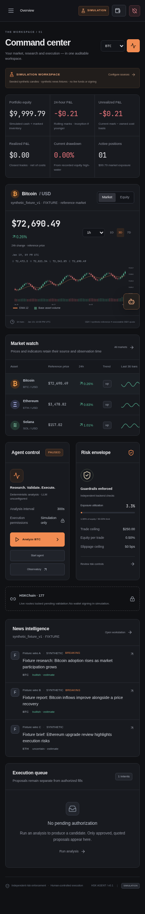

# Reproducible demo and operator workflow

Run the setup commands in the root README. Keep the initial fixture providers selected for the deterministic demonstration. The fixed scenario contains 238 consecutive hourly bars starting 2026-01-10 UTC, synthetic publisher stories and assumed simulation liquidity. Wall-clock retrieval/authorization times remain separate from the virtual fixture analysis clock.

## Five-minute walkthrough

1. **Overview:** inspect the $10,000 initial simulated ledger, zero holdings, synthetic-source notice and locked live integration. Change the chart between market/equity, choose 1D/3D/7D history, and inspect hourly candles with the pointer or arrow keys.
2. **Analyze BTC:** the initial synthetic scenario satisfies the configured momentum and corroborated-news filters. A HOLD is still a legitimate result after parameters, inventory or data change; the system never forces a trade for presentation.
3. **Observatory:** open Analyst Team, Strategy Evaluation and Risk Manager. The outputs contain actual values and evidence IDs. Unconfigured LLM research is SKIPPED, not represented as a completed model call. Stage cards are persisted backend records.
4. **Execution History:** inspect the exact input, expected output, minimum received, fee/slippage/impact assumptions, risk checks and expiry. Use the clearly named authorization button. If a quote expires, refresh it; if its proposal or configuration has expired, run a new analysis.
5. **Positions:** verify the quantity, marked value, cost basis, negative initial execution costs and exit policy. A `sim:` receipt is not a blockchain transaction. Previewing an exit does not execute it.
6. **Strategies:** adjust a permitted EMA/RSI/cooldown value and save. The configuration version increments. Run a chronological backtest and inspect assumptions, fees, in-sample and holdout results. Unknown metrics remain blank.
7. **News Intelligence:** filter the normalized feed, inspect a story, publication/retrieval/availability times, relevant assets, limitations and original URL. Fixture links use `example.invalid` deliberately.
8. **Assistant:** ask for exposure, the latest rejection reason, a news summary or strategy comparison. Try `Disable momentum strategy` or `Lower maximum trade size to 0.5% of equity`. Raw chat is not persisted. An execution request does not bypass the preview.
9. **Emergency stop:** press E-stop while a preview exists. New authorization is blocked. Review Risk Controls, explicitly clear the latch, then resume separately. No liquidation is sent automatically.

## Autonomous simulation

In Settings, choose an analysis interval of at least 30 seconds. Starting without the automatic-fill checkbox schedules research and previews only. Explicitly selecting automatic **simulated** fills grants permission only to the local simulation ledger; all risk, freshness, cooldown and duplicate checks still run.

The fixed fixture does not manufacture a new market bar every interval. Re-evaluating the same signal cannot replay an already completed intent. Use the real reference-market provider for changing observed data, while execution still stays simulated. Do not compare P&L across a mid-ledger change of market sources; use a separate database instead.

Pause blocks entries while retaining read-only monitoring. Stop ends scheduled evaluation. Orderly shutdown stops scheduled operation, and emergency stop remains latched until explicit acknowledgement. The default breach policy holds inventory for review.

## Production-build restart proof

```bash
npm run build
.venv/bin/python -m scripts.production_smoke
```

This starts two real Uvicorn lifetimes against a newly created isolated simulation database. It serves the built frontend, creates and reconciles one simulated fill, starts the scheduler without automatic-fill permission, restarts, and checks balances, ledger uniqueness and PAUSED recovery. It never inherits live providers or submits a blockchain transaction. Its sanitized report is written to `artifacts/production-smoke.json`.

## Optional legacy paper workflow

The original Dash/CLI dependencies are intentionally separate from the lightweight terminal runtime. Their full execution is not part of the verified demo. To inspect them in an isolated environment:

```bash
uv venv .venv-legacy --python 3.12
uv pip install --python .venv-legacy/bin/python -r docs/upstream/requirements.txt
ALPACA_USE_PAPER=True .venv-legacy/bin/python run_webui_dash.py
```

Keep the project-local uv cache variables from the README set. This optional installation downloads the original broker/LLM/embedding/UI dependency set and may require compatibility review. Supply only paper-account credentials. The terminal does not call that broker workflow as an HSKSwap fallback.


