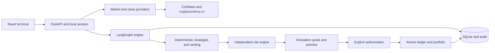
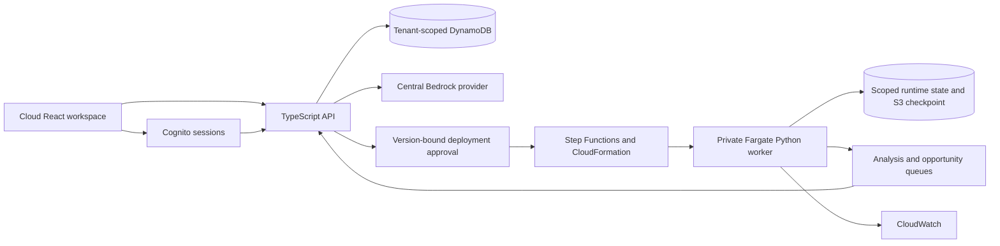

# Architecture and request flows

## Local terminal

`npm run dev` starts FastAPI and Vite. The browser obtains a local HttpOnly session through `POST /api/session`; mutations carry a CSRF token. It polls the dashboard at the configured ticker interval. The backend independently caches short-lived tickers, longer-lived closed candles and news. It never substitutes fixture prices after a live provider fails.

`POST /api/runs` enters `Engine.run`. Its stages collect data, derive indicators, normalize news evidence, optionally consult preserved research nodes, evaluate enabled strategies, rank eligible signals and construct a proposal. HOLD is a valid outcome, not a failed trade. Missing evidence is explicitly blocked or unavailable.

The proposal carries source/timestamps, strategy and risk versions, provider version, runtime fingerprint, proposed amount and exit policy. Its ID includes the candidate amount and data/configuration context. Two different amounts do not overwrite the same candidate.

Risk checks may approve, reduce or reject. An approved signal still has no permission to fill. The simulation adapter creates a fresh quote under disclosed fee, slippage and liquidity assumptions. A user authorizes that specific intent and quote. Immediately beforehand, the engine refreshes markets and rechecks source, configuration, price movement, risk, quote identity and expiry. Authorization, simulated receipt, ledger entry and reconciliation commit atomically. A simulation receipt is not a blockchain transaction hash.

Every observed complete portfolio valuation can advance a persisted high-water mark. Chart snapshots are sampled independently. This prevents a peak between chart samples from disappearing from the drawdown check. Unknown position marks produce incomplete valuation and block new risk-taking.

## Cloud platform

Cognito claims establish the tenant; request bodies cannot select another user. Conversation tools read actual profiles/agents and create validated declarative drafts. They cannot run shell commands, choose arbitrary container images, grant themselves permissions or submit a live swap.

A deployment approval binds the reviewed specification/version and image. A persisted outbox starts a named workflow. The approved template creates an isolated role/task/service. A healthy ECS task and fresh worker heartbeat are required before the API reports it running. Worker activation waits for the old deployment's lease/checkpoint to drain. Failed upgrades preserve the previous deployment paused for review.

Workers execute the existing Python framework. They send stored evidence pointers to the centralized model dispatcher. A model review can veto an entry or contribute bounded strategy context. It cannot override eligibility or risk. Research opportunities are delivered only to explicitly linked agents in the same tenant.

## Failure and recovery

- Provider outage: retain original cached timestamps, mark STALE or UNAVAILABLE and apply a retry cooldown.
- Configuration/source/price change: reject the old preview and require a new analysis.
- Duplicate authorization: the consumed intent and unique ledger key prevent another fill.
- Unknown execution: retain a recovery state; do not resend blindly.
- Emergency stop: block new execution at the backend; retain inventory for review rather than automatically liquidating.
- Worker replacement: a lease fences execution/checkpoint updates; an old worker cannot advance the durable checkpoint pointer.
- Missing AWS configuration: show setup/unavailable states. Local fixture tests do not turn them into deployments.
